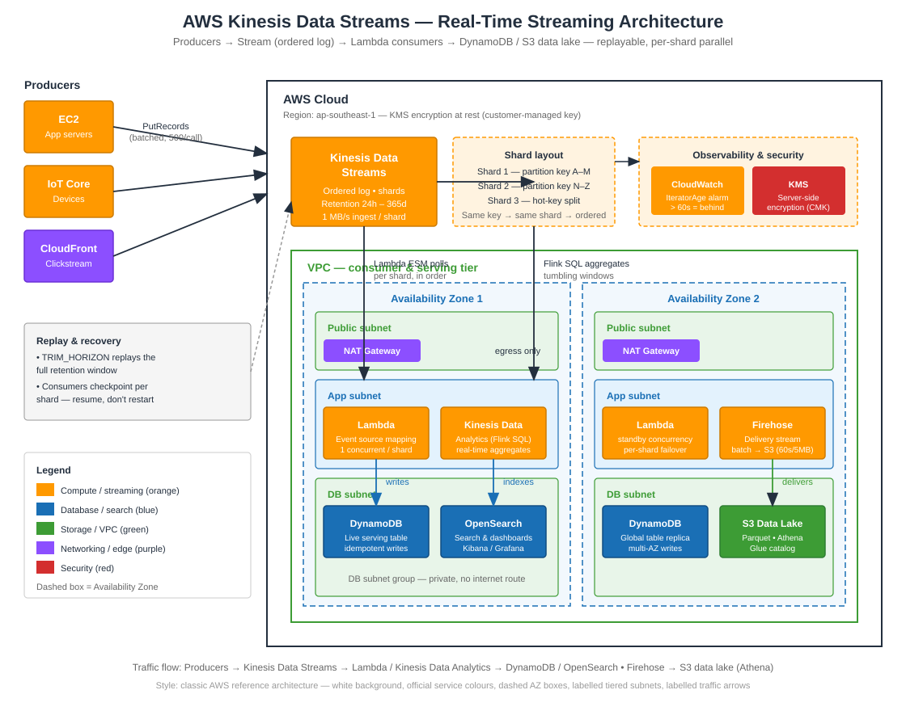

# AWS Kinesis Data Streams — Real-Time Streaming Done Right


> **TL;DR:** Kinesis Data Streams is the durable, ordered log your real-time system is built on. Pick the right shard count, choose a partition key that actually spreads load, and let Lambda (or Kinesis Data Analytics) do the processing — never let a consumer fall behind silently.

---

## What This Guide Covers

- Shard math: how throughput, retention, and cost really scale
- Partition keys, hot shards, and the enhanced fan-out decision
- Producer patterns (PutRecord vs PutRecords, aggregation, retries)
- Consumer patterns (Lambda ESM, KCL, enhanced fan-out, checkpoints)
- Exactly-once-ish processing, ordering guarantees, and replay
- Delivery to S3 via Firehose, analytics with Kinesis Data Analytics
- Monitoring, alarming, and the cost levers that actually matter

---

## Architecture



**Flow:** Producers (apps, IoT, clickstream) → **Kinesis Data Streams** (shards, ordered per partition key, 24h–365d retention) → **Lambda** (event source mapping, parallel per shard) → **DynamoDB / OpenSearch** for live serving; in parallel **Kinesis Data Firehose** batches records to **S3** (data lake) and **Kinesis Data Analytics** runs real-time SQL aggregations. **CloudWatch** alarms on iterator age; **KMS** encrypts data at rest.

---

## Shard Math (the part everyone gets wrong)

| Metric | Per shard |
|---|---|
| Ingest | 1 MB/s or 1,000 records/s |
| Read (shared) | 2 MB/s |
| Read (enhanced fan-out) | 2 MB/s **dedicated per consumer** |
| Records | Max 1 MB per record |
| Retention | 24 h default, up to 365 days |

**Sizing rule:** `shards = max(peak_MB_per_s, peak_records_per_s / 1000)`, then add 20–30% headroom. Re-shard (split/merge) when sustained throughput crosses ~70% of capacity — never wait for `WriteProvisionedThroughputExceeded`.

## Kinesis vs the Alternatives

| | Kinesis Data Streams | SQS | MSK (Kafka) | Firehose |
|---|---|---|---|---|
| Model | Ordered log, replayable | Queue, at-least-once | Ordered log, self-managed | Delivery stream |
| Ordering | Per partition key | FIFO only | Per partition | None |
| Retention | Up to 365 days | Up to 14 days | Configurable | N/A (delivery) |
| Consumers | Many, parallel per shard | Competing | Consumer groups | One destination |
| Best for | Real-time analytics, replay | Decoupling, buffering | Kafka ecosystem, high control | S3 / warehouse loading |

## Quick Start

```python
# Producer: batch 500 records per call, aggregate by partition key
from kinesis_demo import KinesisProducer

producer = KinesisProducer(stream_name="clickstream-events")
producer.put_events([
    {"user_id": "u-123", "event": "page_view", "page": "/pricing"},
    {"user_id": "u-456", "event": "add_to_cart", "sku": "SKU-99"},
])
```

```python
# Consumer: Lambda handler with checkpoint-friendly batching
def lambda_handler(event, context):
    for record in event["Records"]:
        process(json.loads(base64.b64decode(record["kinesis"]["data"])))
    # Return partial batch failures so only failed records retry
    return {"batchItemFailures": [...]}
```

## Partition Key Rules

1. **High cardinality** — user IDs, device IDs, session IDs. Never use a constant or a date.
2. **Even distribution** — a key that maps 80% of traffic to one shard is a hot shard, and no amount of scaling fixes it.
3. **Ordering scope** — records with the same key stay ordered *within a shard*. If you need global order, you need one shard (and its limits).
4. **Re-shard on key change** — splitting a shard re-hashes keys; consumers must handle rebalancing.

## Producer Checklist

- [ ] Use `PutRecords` (up to 500 records / 5 MB per call), not one `PutRecord` per event
- [ ] Enable **KPL aggregation** or aggregate yourself — fewer, larger records = lower cost
- [ ] Retry with exponential backoff + jitter on `ProvisionedThroughputExceededException`
- [ ] Set `StreamARN` + `StreamMode` explicitly (on-demand vs provisioned is a cost decision, not a default)
- [ ] Encrypt with a customer-managed KMS key; verify the key policy allows `kinesis:*`

## Consumer Checklist

- [ ] Lambda ESM: set `BisectBatchOnFunctionError` + `MaximumBatchingWindowInSeconds`
- [ ] Return `batchItemFailures` — never reprocess a whole batch for one bad record
- [ ] Alarm on **IteratorAge** > 60 s (consumer is falling behind) and **ReadProvisionedThroughputExceeded**
- [ ] Use enhanced fan-out only when a consumer genuinely needs dedicated 2 MB/s (it costs per consumer-shard-hour)
- [ ] Test replay: reset the iterator to `TRIM_HORIZON` and confirm idempotent processing

## Cost Levers

| Lever | Saving |
|---|---|
| On-demand mode for spiky, unpredictable traffic | No idle shard cost |
| Provisioned + right-sized shards for steady traffic | ~40–60% cheaper than on-demand at scale |
| KPL aggregation | Fewer records → fewer PUT charges |
| Firehose instead of a custom consumer for S3 delivery | No Lambda / consumer infra to run |
| Short retention (24 h) unless replay is a real requirement | Retention is charged per shard-hour |

## Common Mistakes

1. **One partition key for everything** — a hot shard throttles the whole stream.
2. **No IteratorAge alarm** — you discover the backlog when the data is already stale.
3. **Reprocessing entire batches on one failure** — duplicate side effects everywhere.
4. **Enhanced fan-out for every consumer** — the bill scales with consumers × shards.
5. **Treating Kinesis as a queue** — it's a log; consumers read at their own pace, and retention is your replay window.

## Files

| File | What it is |
|---|---|
| `README.md` | This guide |
| `architecture.svg` | Classic AWS reference-style architecture diagram |
| `kinesis_demo.py` | Producer + Lambda consumer, runnable offline in `--demo` mode |
| `quiz.md` | 5 questions to test what stuck |

---

## Quiz Teaser

> A stream ingests 3.5 MB/s at peak. How many shards do you need — and what breaks first if your partition key is the event type (only 4 distinct values)? Answers in [`quiz.md`](quiz.md).
